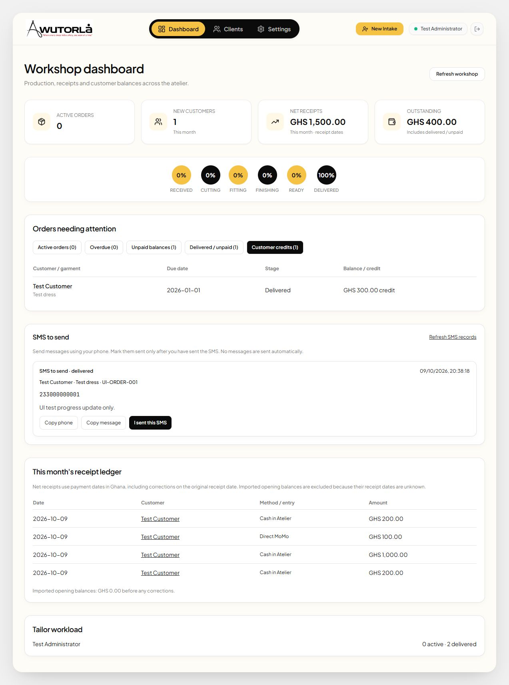
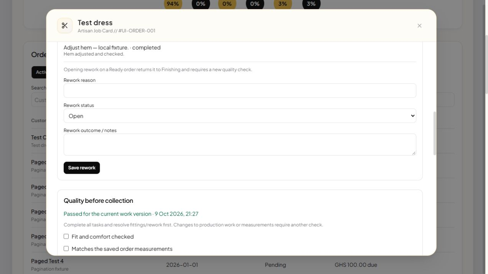

# Implementation review — phases 1–6 in manual mode

Reviewed 9 October 2026. The code and migration are implemented locally. No live
database migration, production deployment, real payment transaction or SMS was made.

## Completed

| Phase | Delivered |
| --- | --- |
| 1 — Manual workflow | Staff-only app. Stage changes queue a progress message without Hubtel. Staff copy the phone/message and separately confirm a manual send. Sender identity/time are recorded. Outdated unsent updates are superseded. Old automatic sender and client endpoints have HTTP 410 retirement handlers. |
| 2 — Payment integrity | Append-only receipt ledger, actual receipt dates, method/reference/notes/staff, transactional additions, stable submission keys, explicit overpayment credit and admin-only corrections. Originals remain visible and production history is preserved. Initial intake deposits use the same ledger transaction. |
| 3 — Measurements | Header, unit, notes and values save in one transaction. Stale revisions are rejected. Blanks clear measurements rather than becoming zero. Orders have saved values and parameter labels; master edits cannot silently change them. Applying a newer version to an active order requires an explicit action. |
| 4 — Reporting | Monthly net receipts use payment dates and correction entries. Delivered unpaid orders remain in debt. Overdue/unpaid/delivered-debt/credit views and an SMS queue are available. Currency is fixed to GHS. Reports page through records rather than silently stopping at PostgREST response limits. |
| 5 — Workshop operations | Ghana-time fitting bookings with overlap checks and recorded outcomes; alteration/rework records; admin reopening; versioned quality approval required before Ready/Delivered; immutable audit records; admin-only price/assignment changes with reasons and explicit credit confirmation. |
| 6 — Manual recovery and rollout preparation | Verified admin reconciliation of uncertain SMS, independent notification cycles for reopened work, server-computed totals and paged order/customer/receipt search, staff-specific offline measurement drafts with explicit sync/conflict review, private attachment renewal and protected upload cleanup. Hubtel/provider dispatch remains deferred as requested. |

The earlier access-code/password reset bugs, client-created financial records,
public tracker and public invoice sharing no longer apply. Client access policies
are replaced, file buckets are private, and account role grants use trusted app
metadata. These protections require migrations 05–08 plus endpoint retirement
on the live system; old auth identities are preserved but receive no workshop access.

## Preservation and operational limits

- **Legacy money:** paid totals are imported as opening balances. Unknown receipt
  dates are not invented, so imported balances do not count as this month's cash
  receipts. An admin can reconcile an opening entry by reversing it and recording
  verified dated receipts; keep the supporting reference/notes.
- **Legacy measurements:** original intake dimensions cannot be reconstructed.
  Migration snapshots clearly identify that they were taken from the master record
  at migration time. Later master edits preserve those snapshots.
- **Credit:** shown per order and retained in its ledger. There is no automatic
  refund or transfer between orders. Corrections reverse incorrect records and use
  their original receipt dates; actual cash refunds need a separate audited workflow.
- **SMS:** confirmation means staff recorded a manual send, not handset delivery.
  Previously uncertain provider submissions need review before any resend. No
  provider credentials, background sender or retry automation are active.
- **Dates:** new due dates use a calendar input. Reports also recognize the previous
  `AUG 24, 2026` format. Unrecognizable legacy dates need staff correction through the
  job card; they are not guessed into overdue totals.
- **Offline support:** confirmed records are cached, but there is no durable offline
  payment/intake/SMS queue. Measurement drafts persist for the current staff owner,
  sync only on request and expose revision conflicts. An already verified staff
  session is required; fresh offline login is not supported. Signing out clears
  drafts. Private attachments renew on card open/focus and every 45 minutes, with a
  manual refresh control. Missing files warn without hiding the whole order list.
- **Uploads:** intake retries reuse order/submission IDs and uploaded file paths,
  protecting against duplicate orders after an uncertain save. Admins can review
  unused uploads older than 48 hours. Intake and deletion lock the storage rows;
  deletion rechecks committed references and cannot remove a saved order file.

## Deployment and intentionally deferred work

1. Apply only missing migrations through **08**, after a backup, retire the old
   endpoints and deploy the frontend. No live deployment has been performed in this
   task. Hosted Auth, Storage and Realtime still need the README smoke tests.
2. Reconcile legacy money/specifications from verified records. Existing Ready
   orders require a current quality check before delivery; older approval is not
   inferred. Review old uncertain SMS against the original provider report.
3. Provider dispatch, delivery receipts and automatic retry remain deferred under
   the user's no-Hubtel/manual-recording decision. They are not active in this build.
4. Cash refunds and transfers between orders remain separate future workflows.
   Existing correction entries fix recording mistakes and do not issue money.

The dependency maintenance is completed: Tailwind 4.3.3/Vite integration preserves
the atelier palette, DOMPurify/source-map-js are patched, and the final npm audit
reports zero vulnerabilities. Lazy page loading removes the main bundle size warning.

## Verification

- All 67 automated checks pass, including 33 PostgreSQL checks and 12 focused
  manual workflow/reporting checks.
- TypeScript/Vite production build passes without a bundle size warning.
- Lint has three Fast Refresh export warnings and no errors.
- Automated checks execute migrations in real PostgreSQL through PGlite, including
  reapplication and relationship preservation, legacy/anonymous permission denial,
  transactional intake/payment/measurement writes, safe retries, reversals, credit,
  stale revision rejection, immutable milestones and GHS validation.
  Added checks cover fitting conflicts, quality gates/invalidation, rework cycles,
  admin audit/terms, verified SMS review, bounded reports, draft retry receipts,
  staff cache ownership and protected upload deletion.
- Focused reporting checks cover dated receipts/corrections, unknown opening dates,
  delivered debt, separate credits, valid legacy dates and loading beyond page limits.
- Browser tests used local fake records to verify manual SMS logging, Delivered
  progression without Hubtel, receipt confirmation and balance updates, credit
  confirmation, measurement isolation/explicit replacement and nested dialog Escape.
  Additional browser checks cover later order pages, order search, fitting schedule
  and cancellation, rework completion, fresh quality approval, verified SMS review,
  device-local measurement draft creation and explicit sync to a new master version.
- PGlite auth/storage scaffolding and a fixture HTTP server do not validate the
  hosted Supabase gateway or Realtime service. Follow the [deployment smoke test](../README.md).

